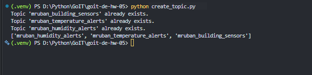
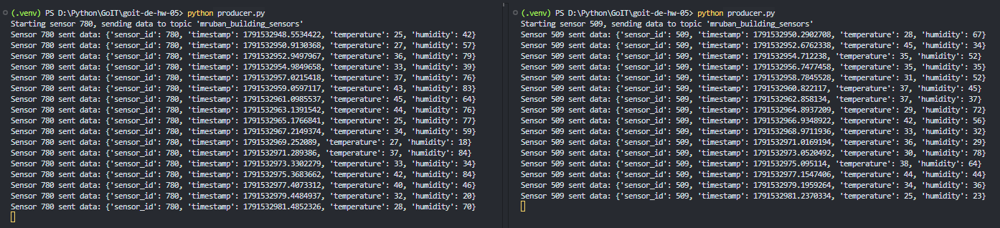
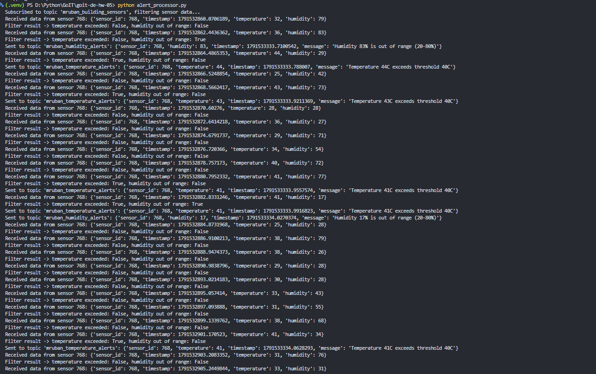
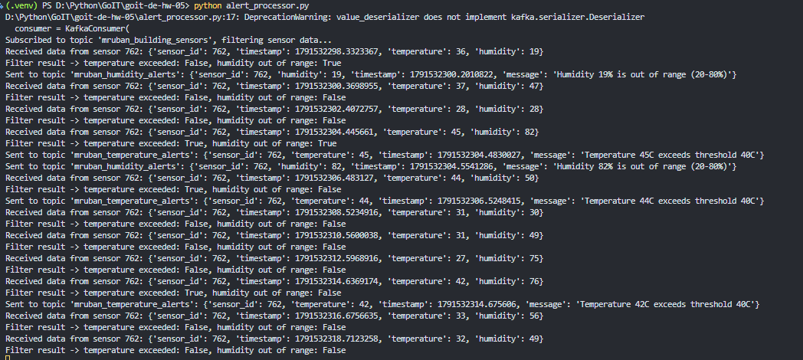
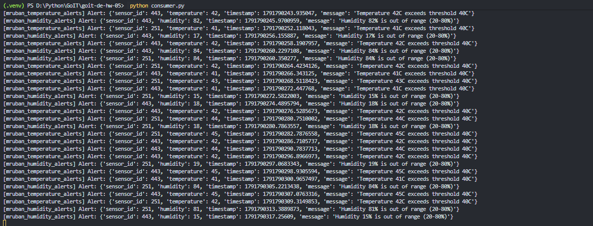

# goit-de-hw-05

Домашнє завдання до теми «Apache Kafka». Система моніторингу IoT-датчиків (температура, вологість) з обробкою даних у реальному часі через Apache Kafka.

## Опис виконання

Обраний підхід до виконання ДЗ: **задовольнитися першою отриманою оцінкою**.

### Архітектура

| Файл | Призначення |
|---|---|
| [configs.py](configs.py) | Налаштування підключення до Kafka та імена топіків |
| [create_topic.py](create_topic.py) | Створення трьох топіків: `building_sensors`, `temperature_alerts`, `humidity_alerts` |
| [producer.py](producer.py) | Імітація одного датчика: генерація та відправка даних (температура, вологість) у `building_sensors` |
| [alert_processor.py](alert_processor.py) | Читання даних з `building_sensors`, фільтрація за порогами та відправка сповіщень у `temperature_alerts` / `humidity_alerts` |
| [consumer.py](consumer.py) | Читання сповіщень з `temperature_alerts` та `humidity_alerts` і вивід на екран |

### Порогові значення фільтрації

- Температура > 40°C → сповіщення в `temperature_alerts`
- Вологість > 80% або < 20% → сповіщення в `humidity_alerts`

## Запуск

Встановити залежності:

```bash
pip install -r requirements.txt
```

Порядок запуску (кожен скрипт — в окремому терміналі):

```bash
# 1. Створити топіки (один раз)
python create_topic.py

# 2. Обробка та фільтрація даних датчиків
python alert_processor.py

# 3. Вивід фінальних сповіщень
python consumer.py

# 4. Один або декілька запусків — кожен імітує окремий датчик
python producer.py
```

## Скриншоти виконання

### 1. Створення трьох топіків

Результат `[print(topic) for topic in admin_client.list_topics() if "my_name" in topic]` — три топіки створено.



### 2. Генерація даних сенсорів та відправка в building_sensors

Два (або більше) одночасні запуски `producer.py`, що імітують різні датчики.



### 3. Отримання даних та фільтрація

`alert_processor.py` отримує дані з `building_sensors` та показує результат фільтрації за порогами.



### 4. Відправка відфільтрованих даних у відповідні топіки

`alert_processor.py` надсилає сповіщення саме в `temperature_alerts` та `humidity_alerts`.



### 5. Результат запису відфільтрованих даних

`consumer.py` зчитує та виводить сповіщення з обох топіків.


